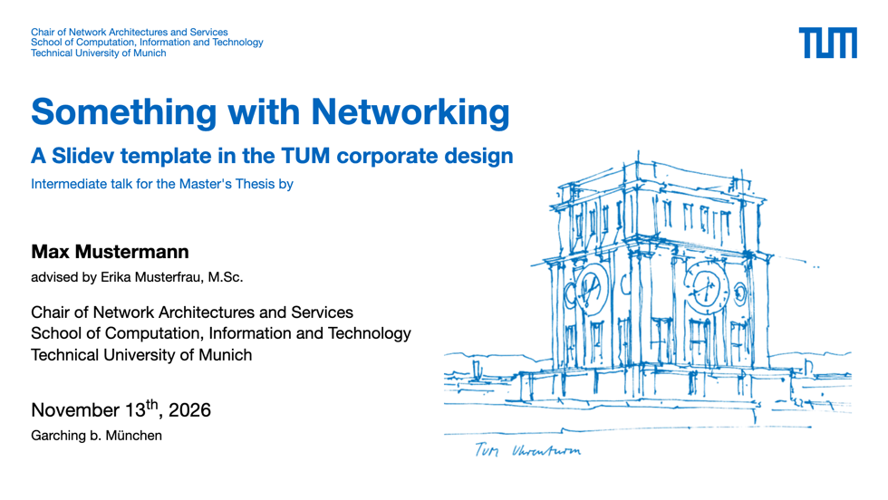

# slidev-theme-tum

[](https://github.com/danielgnth/slidev-tum-theme/actions/workflows/ci.yml)
[](https://www.npmjs.com/package/slidev-theme-tum)
[](https://scorecard.dev/viewer/?uri=github.com/danielgnth/slidev-tum-theme)

[Slidev](https://sli.dev) theme in the TUM corporate design (16:9), with the layouts and helpers of the `tumbeamer` LaTeX class.



**Documentation: https://danielgnth.github.io/slidev-tum-theme/**

## Use it

```bash
pnpm add -D slidev-theme-tum
```

```yaml
---
theme: tum
title: Something with Networking
author: Max Mustermann
themeConfig:
  lang: en # en | de
  chair: Chair of Network Architectures and Services
---
```

18 layouts (`cover`, `section`, `toc`, `two-cols`, `image-right`, `gallery`, `diagram`, `references`, `end`, …), beamer blocks, automatically numbered figures and Mermaid in TUM colours. The package ships an agent skill so AI coding agents write correct decks: see [Writing slides with AI](https://danielgnth.github.io/slidev-tum-theme/ai/).

## Develop it

```bash
mise install && pnpm install   # toolchain from mise.toml, git hooks via lefthook
pnpm dev                       # examples/showcase/slides.md
mise run check                 # lint, typecheck, test, build, docs: what CI runs
```

```text
theme/       the npm package (layouts, components, styles, agent skill)
examples/    showcase deck (every layout) and a starter deck
docs/        documentation site (Zensical)
test/        Vitest
```

See [AGENTS.md](AGENTS.md) for conventions (written for agents, useful for humans), [Development](https://danielgnth.github.io/slidev-tum-theme/development/) for the details, and [Releasing](https://danielgnth.github.io/slidev-tum-theme/development/releasing/) for the release flow with npm trusted publishing and SLSA provenance.
