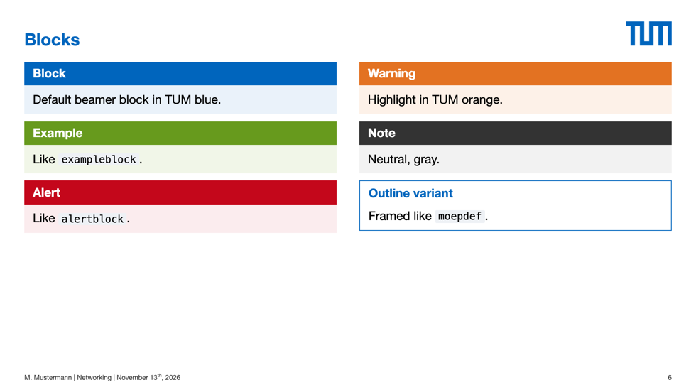

# Components

The components can be used in any slide, inside Markdown.

## `<Block>`

Beamer-style blocks (`block`, `alertblock`, `exampleblock`).

```md
<Block title="Definition">
A *protocol* defines format and order of messages.
</Block>

<Block type="alert" title="Caution">…</Block>
<Block type="example" title="Example" outline>…</Block>
```

| Prop | Default | |
|---|---|---|
| `title` | | text of the title bar, or use the `#title` slot |
| `type` | `info` | `info` \| `alert` \| `example` \| `warning` \| `note` |
| `outline` | `false` | framed instead of filled |

{ .slide }

Leave an empty line after the opening tag when the body is Markdown.

## `<Figure>`

An inline figure with an optional caption, usable in any layout.

```md
<Figure src="/images/setup.svg" caption="Inline figure" height="110px" />
```

| Prop | |
|---|---|
| `src` | image path, e.g. `/images/x.svg` |
| `caption` | caption text, or use the default slot |
| `n` | figure number; inline figures are not numbered automatically |
| `label` | replaces "Figure", e.g. `Table` |
| `width`, `height` | CSS sizes |
| `fit` | `contain` (default) or `cover` |
| `alt` | defaults to the caption |

## `<Caption>`

A caption on its own, e.g. below a table:

```md
<Caption label="Table" n="1">Results</Caption>
```

## `<Yes/>`, `<No/>`, `<Maybe/>`

Green check, red cross and orange circle, like `\yes`, `\no` and `\maybe` from the LaTeX template:

```md
| | Competitor | we |
|---|:-:|:-:|
| Feature A | <No/> | <Yes/> |
| Feature B | <Maybe/> | <Yes/> |
```

## `<TumLogo>`

```md
<TumLogo />                          <!-- TUM blue, 28px high -->
<TumLogo color="white" :height="40" />
```

`color` takes any CSS colour, `height` a number (px) or a CSS length.
