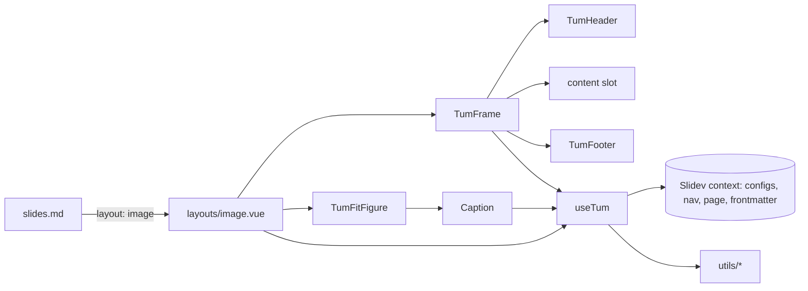

# Architecture

## Repository

```text
theme/                 the npm package slidev-theme-tum (shipped as source, Slidev compiles it)
  layouts/             one .vue file per layout, named as used in `layout:`
  components/          public: Block, Caption, Figure, TumLogo, Yes, No, Maybe
                       internal (Tum*): TumFrame, TumHeader, TumFooter, TumFitFigure, TumTower
  composables/         useTum (all deck state in one place), useFitMermaid
  utils/               pure functions, unit tested: format (dates, footer), i18n, slides (counters)
  styles/              tokens.css → frame → typography → tables → figures → components → layouts/*
  setup/mermaid.ts     Mermaid theme
  colors.ts            TUM palette, single source for UnoCSS and Mermaid
  types.ts             TumThemeConfig and prop types
  uno.config.ts        palette as utilities (text-tum-blue, …)
  assets/              Uhrenturm drawing
  skills/slidev-tum/   agent skill shipped with the package
examples/
  showcase/            every layout and component, with its own public/ for sample images
  starter/             minimal deck to copy
test/                  Vitest
types/                 ambient types for type-checking outside a Slidev build
docs/                  this site (Zensical)
```

## How a slide is rendered



- **`TumFrame`** draws the chrome shared by all content layouts: header (`compact` / `full` / none), the body area and the footer. Layouts only fill the body.
- **`useTum`** is the only place that reads Slidev state. It returns the theme config, the labels for the deck language, the footer, and the section and figure numbers of the current slide.
- **`utils/`** holds the logic as pure functions (no Vue, no Slidev), which keeps it easy to test.

## Styles

The CSS is plain, global and ordered (`styles/index.ts`). Tokens (colours, geometry, type sizes) are CSS variables in `tokens.css`, so decks can override them. Geometry follows the official TUM title slide. The canvas is 960 px wide rather than Slidev's default 980 px: 960 scales to common screens by clean factors (2× on 1920×1080, 1.5× on a 1440×900 Retina display), so edges land on whole device pixels. At 980 px the scale is 1.959 and every edge is smeared across two pixels. The TUM logo additionally uses `shape-rendering: crispEdges`, because its bars never fall on whole pixels at slide sizes.

`colors.ts` is the single source of the palette. `tokens.css` repeats the subset it needs, and a test keeps the two in sync.

## Why `@slidev/client` is stubbed for type-checking

`@slidev/client` ships raw TypeScript that depends on Slidev's build-time globals and its whole dependency tree. `tsconfig.json` maps the import to `types/slidev-client.d.ts`, which declares the part the theme uses. The real module is used at runtime and in `pnpm build`.
