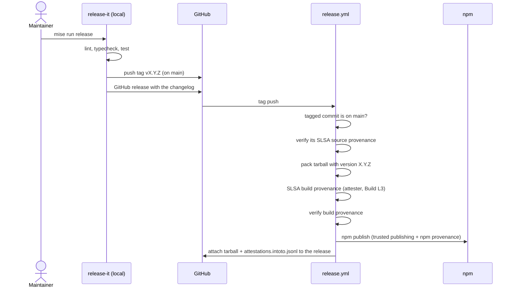

# Releasing

Versions are git tags. `theme/package.json` carries a placeholder version (`0.0.0-development`); the release workflow writes the version from the tag into the package it builds. The GitHub releases are the changelog. Only CI publishes; no npm token exists anywhere.



## Cutting a release

```bash
git switch main && git pull
mise run release          # or: mise run release -- minor | major | 1.2.3 | --dry-run
```

`mise run release` runs [release-it](https://github.com/release-it/release-it) with a GitHub token from `gh auth token`. release-it:

1. runs lint, typecheck and tests,
2. derives the next version from the Conventional Commits since the last tag (`feat` → minor, `fix` → patch, `!` → major),
3. creates the annotated tag `vX.Y.Z` on the current commit of `main` and pushes it,
4. creates the GitHub release with the changelog of those commits.

Nothing is committed and `main` stays protected: only the tag is pushed. The tag starts `release.yml`, which publishes to npm and attaches the tarball and its provenance to the release.

## Dry run

```bash
gh workflow run release.yml --ref main
```

Runs the whole release workflow on the current `main` with a throwaway version (`0.0.0-dry-run.<run>`). The source check, build, smoke test, build attestation and its verification run for real; `npm publish` runs with `--dry-run`, nothing is uploaded, and no npm credentials are used. Run it after changing `release.yml`, before tagging.

## What the workflow guarantees

| Track | Evidence | Where |
|---|---|---|
| SLSA **Source** | source provenance and VSA for every revision of `main` (`slsa-source.yml`), signed by the official `slsa-framework/actions` workflow | git notes of the commit |
| SLSA **Build** L3 | provenance of the tarball by the [SLSA attester](https://github.com/slsa-framework/attester), observed from a separate job and signed by `attest_actions.yml` | release asset `attestations.intoto.jsonl` |
| npm provenance | Sigstore-signed statement linking the package to the workflow run | npmjs.com package page |

The workflow refuses tags that are not on `main`, and verifies the source level of the tagged commit and the build provenance of the exact tarball **before** `npm publish`, so an unverified artifact never reaches the registry.

## Verifying a release

```bash
# npm provenance and registry signatures of everything installed
npm audit signatures

# SLSA build provenance of the tarball
gh release download v1.2.3 -R danielgnth/slidev-tum-theme
slsa-verifier build attestations.intoto.jsonl slidev-theme-tum-1.2.3.tgz \
  --param expected_source=github.com/danielgnth/slidev-tum-theme \
  --param trusted_builders=https://github.com/danielgnth/slidev-tum-theme/.github/workflows/release.yml \
  --require-signatures --level 3

# SLSA source level of the tagged commit (the attestations live in its git note)
git fetch origin 'refs/notes/*:refs/notes/*'
commit="$(git rev-parse 'v1.2.3^{commit}')"
git notes show "$commit" > source.intoto.jsonl
slsa-verifier source source.intoto.jsonl "$commit" \
  --expected-repo https://github.com/danielgnth/slidev-tum-theme \
  --expected-branch refs/heads/main --official
```

[slsa-verifier](https://github.com/slsa-framework/verifier) can be installed from its releases or with the `slsa-framework/actions/install/verifier` action.

## One-time setup

1. **First publish.** npm can only trust a workflow for a package that exists, so publish the first version once by hand, from an up-to-date `main`:

    ```bash
    cd theme
    npm publish --access public --provenance=false
    ```

    `--provenance=false` is needed because `publishConfig.provenance` is on, and npm can only create provenance inside CI. Outside CI it fails with `Automatic provenance generation not supported for provider: null`, which also guards against accidental local publishes later. This first version has no provenance; every release after it does.
2. **Trusted publisher.** On npmjs.com → package → *Settings* → *Trusted publishing*: GitHub Actions, repository `danielgnth/slidev-tum-theme`, workflow `release.yml`, environment `npm`. Then set *Publishing access* to "Require two-factor authentication and disallow tokens".
3. **Environment.** The environment `npm` only accepts deployments from tags matching `v*` (repository settings → *Environments*). Add required reviewers if releases should need a second approval.
4. **Rulesets.** The SLSA source tool reads the controls from the repository rulesets:
    - **Tags:** a ruleset for all tags (`~ALL`, no exclusions) that blocks deletion, updates and non-fast-forward pushes. This is the *protected refs* control (L3), and *safe expunge* (L2) depends on it: without it the release stops at Source Level 1.
    - **`main`:** block force pushes and deletions (*continuity*, L2), require pull requests and the `ci-ok` status check.
    - *Two-party review* (L4) additionally needs at least one approval, dismissing stale reviews, code owner review and approval of the last push, which a single-maintainer repository cannot satisfy.
5. **Source level.** The release requires Source Level 2 by default. With both rulesets in place, revisions reach Level 3: set the repository variable `SLSA_SOURCE_LEVEL` to `3`. Controls count from the push after they were enabled, because the source provenance is computed when a commit lands on `main`.
6. **Pages.** *Settings* → *Pages* → Source: GitHub Actions.
