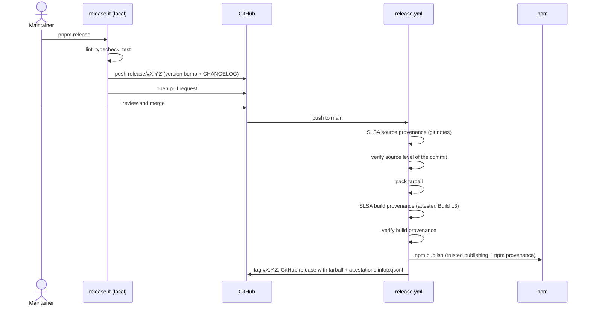

# Releasing

Releases go through a pull request, so `main` can stay protected. The release workflow publishes from CI only: no npm token exists anywhere.



## Cutting a release

```bash
git switch main && git pull
pnpm release          # or: pnpm release minor | major | 1.2.3 | --dry-run
```

[release-it](https://github.com/release-it/release-it):

1. runs lint, typecheck and tests,
2. derives the next version from the Conventional Commits since the last tag (`feat` → minor, `fix` → patch, `!` → major),
3. bumps `theme/package.json` and prepends the section to `CHANGELOG.md`,
4. commits `chore(release): vX.Y.Z` on a new branch `release/vX.Y.Z` and pushes it,
5. opens the pull request with `gh` (or prints what to open).

Merging the pull request publishes: a push to `main` whose commit title is `chore(release): vX.Y.Z` and whose version has no tag yet is a release. Squash-merge keeps that title. `workflow_dispatch` releases the current version manually if it is not tagged yet.

## What the workflow guarantees

| Track | Evidence | Where |
|---|---|---|
| SLSA **Source** | source provenance and VSA for every revision of `main`, signed by the official `slsa-framework/actions` workflow | git notes of the commit |
| SLSA **Build** L3 | provenance of the tarball by the [SLSA attester](https://github.com/slsa-framework/attester), observed from a separate job and signed by `attest_actions.yml` | release asset `attestations.intoto.jsonl` |
| npm provenance | Sigstore-signed statement linking the package to the workflow run | npmjs.com package page |

The publish job verifies the source level of the commit and the build provenance of the exact tarball **before** `npm publish`, so an unverified artifact never reaches the registry.

## Verifying a release

```bash
# npm provenance and registry signatures of everything installed
npm audit signatures

# SLSA build provenance of the tarball
gh release download v1.2.3 -R danielgnth/slidev-tum-theme
slsa-verifier build attestations.intoto.jsonl slidev-theme-tum-1.2.3.tgz \
  --param expected_source=github.com/danielgnth/slidev-tum-theme \
  --param trusted_builders=https://github.com/danielgnth/slidev-tum-theme/.github/workflows/release.yml \
  --require-signatures --level 3

# SLSA source level of the tagged commit (the attestations live in its git note)
git fetch origin 'refs/notes/*:refs/notes/*'
commit="$(git rev-parse 'v1.2.3^{commit}')"
git notes show "$commit" > source.intoto.jsonl
slsa-verifier source source.intoto.jsonl "$commit" \
  --expected-repo https://github.com/danielgnth/slidev-tum-theme \
  --expected-branch refs/heads/main --official
```

[slsa-verifier](https://github.com/slsa-framework/verifier) can be installed from its releases or with the `slsa-framework/actions/install/verifier` action.

## One-time setup

1. **First publish.** npm can only trust a workflow for a package that exists. Publish `0.0.0` (or the first version) once by hand: `cd theme && npm publish --access public`.
2. **Trusted publisher.** On npmjs.com → package → *Settings* → *Trusted publishing*: GitHub Actions, repository `danielgnth/slidev-tum-theme`, workflow `release.yml`, environment `npm`. Then set *Publishing access* to "Require two-factor authentication and disallow tokens".
3. **Environment.** In the GitHub repository settings, create the environment `npm` and limit it to the `main` branch. Add required reviewers if releases should need a second approval.
4. **Branch ruleset for `main`.** Block force pushes and deletions, require pull requests and the `ci-ok` status check. The SLSA source track measures these controls: Source L2 needs continuous, immutable history, L3 needs them enforced.
5. **Source level.** The release requires Source level 2 by default. Once the ruleset is in place, set the repository variable `SLSA_SOURCE_LEVEL` to `3`.
6. **Pages.** *Settings* → *Pages* → Source: GitHub Actions.
