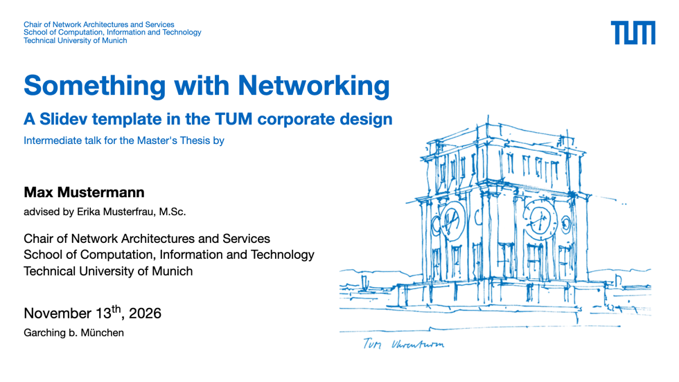
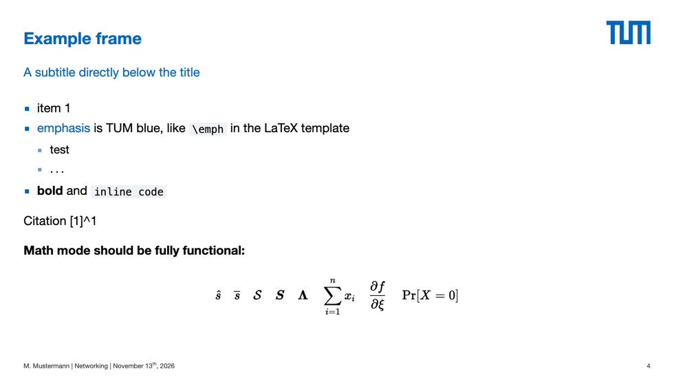
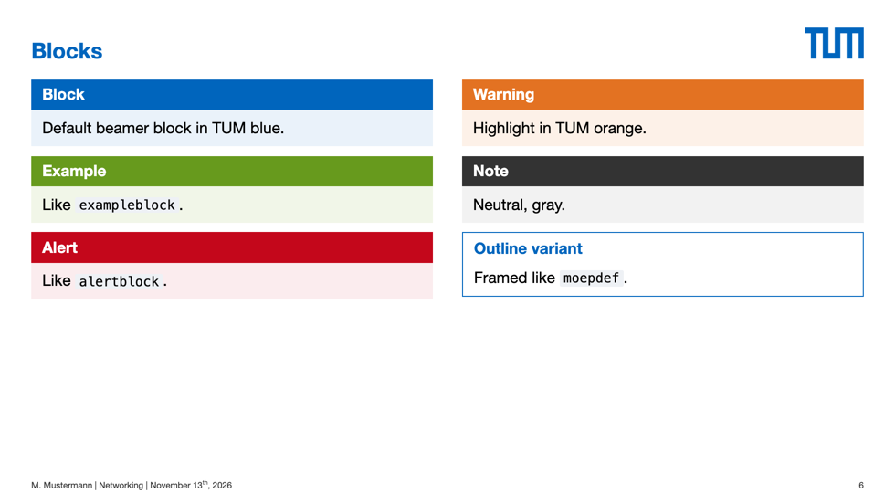
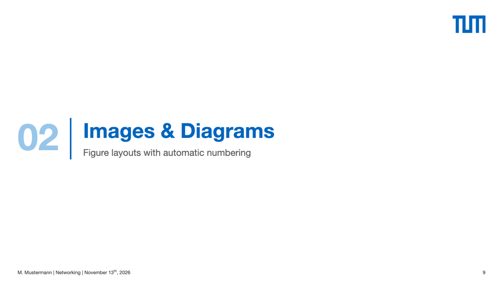
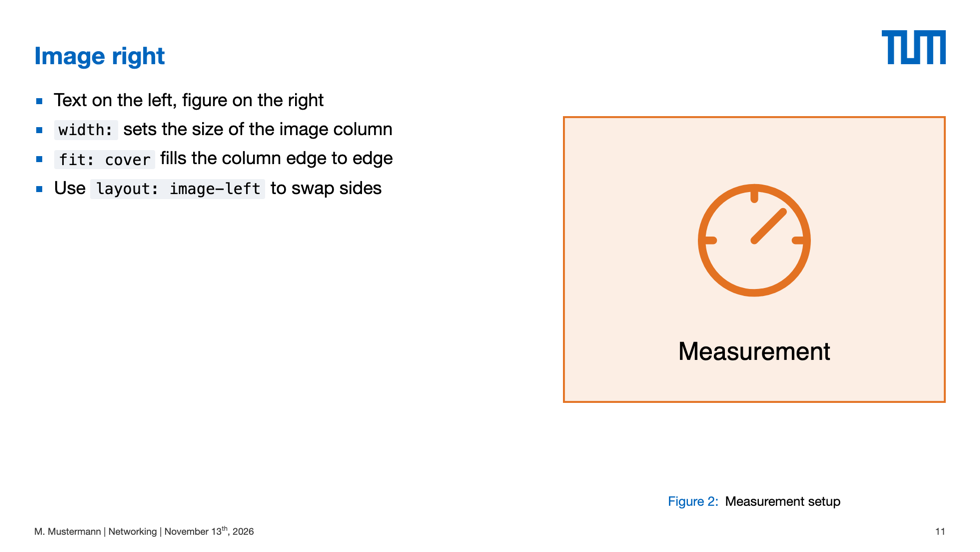
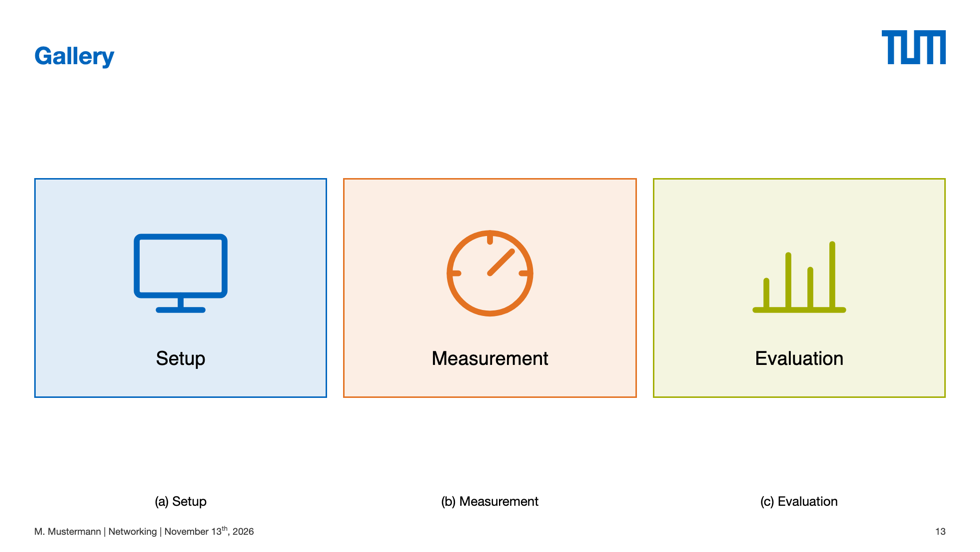
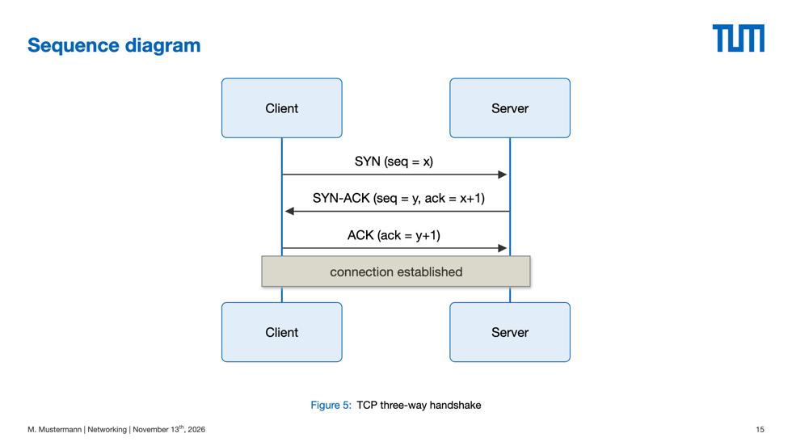

# slidev-theme-tum

A [Slidev](https://sli.dev) theme in the corporate design of the Technical University of Munich (16:9). It brings the layouts and helpers of the `tumbeamer` LaTeX class to Markdown slides: title slide with the Uhrenturm, numbered sections, an outline generated from them, beamer blocks, figures with automatic numbering, booktabs tables and Mermaid diagrams in TUM colours.

{ .slide }

## Quick start

```bash
pnpm create slidev my-talk   # or: npm init slidev@latest my-talk
cd my-talk
pnpm add -D slidev-theme-tum
```

```yaml title="slides.md"
---
theme: tum
title: Something with Networking
author: Max Mustermann
themeConfig:
  chair: Chair of Network Architectures and Services
---
```

Then `pnpm dev`. The [getting started guide](getting-started.md) has the details, including a German deck and PDF export.

## What you get

<div class="grid slides" markdown>

{ .slide }

{ .slide }

{ .slide }

{ .slide }

{ .slide }

{ .slide }

</div>

- **18 layouts** for everything in a thesis or lecture talk: see [Layouts](layouts.md)
- **Components** `<Block>`, `<Figure>`, `<Caption>`, `<Yes/>`, `<No/>`, `<Maybe/>`, `<TumLogo>`: see [Components](components.md)
- **English and German** labels ("Figure"/"Abbildung", "advised by"/"Betreuer:")
- **The full TUM palette** as UnoCSS utilities (`text-tum-blue`, `bg-tum-orange`, …): see [Styling](styling.md)
- **Ready for AI agents**: the package ships an agent skill so Claude Code, Copilot and others write decks that use the theme correctly: see [Writing slides with AI](ai.md)

!!! note "Not an official TUM product"
    This theme follows the public TUM corporate design guidelines. Use the TUM logo only as the corporate design allows.
