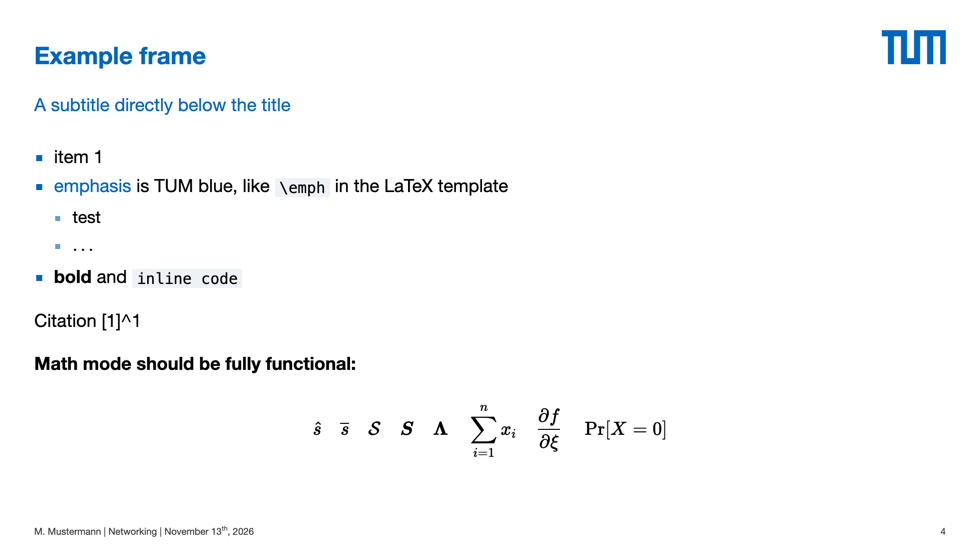
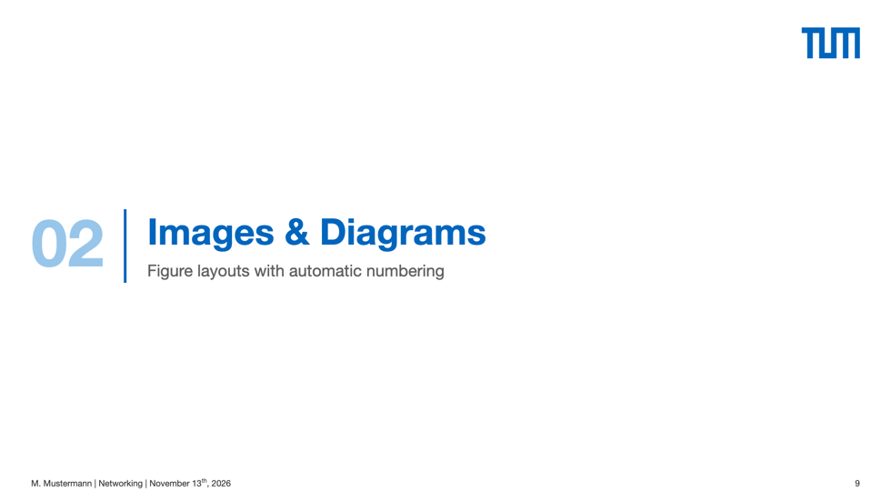
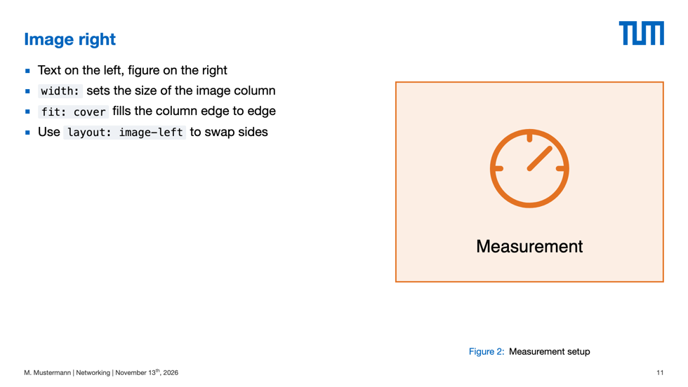
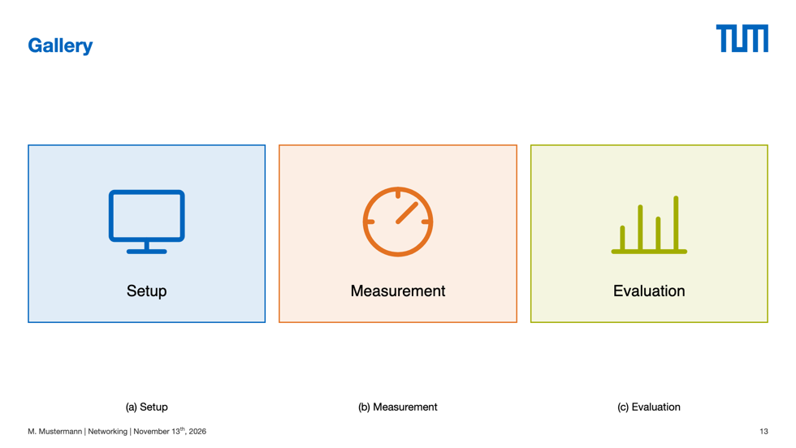
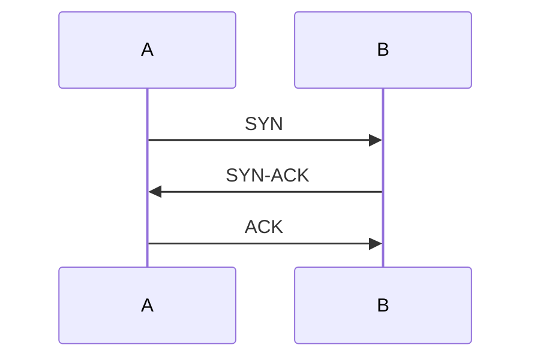
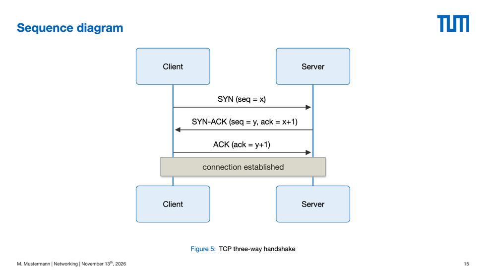
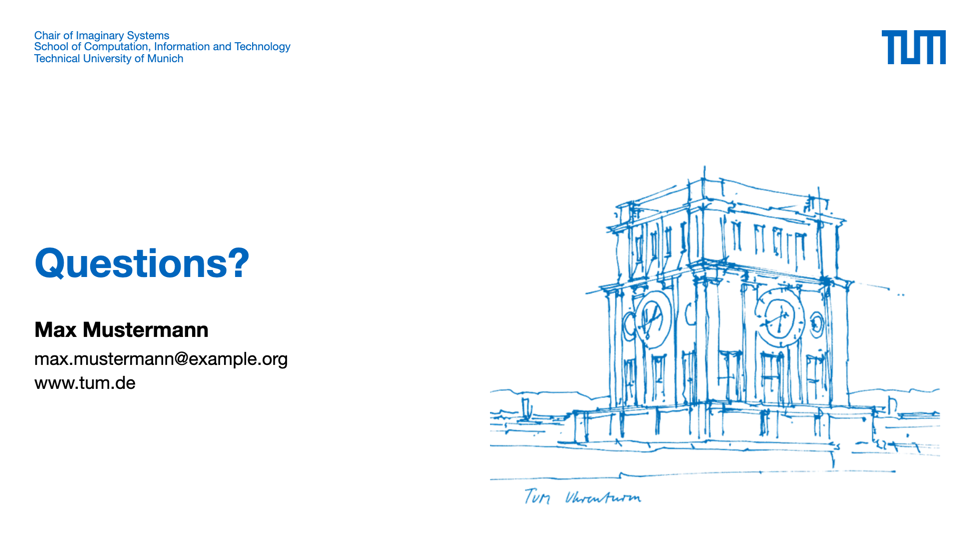

# Layouts

Set a layout in the frontmatter of a slide: `layout: section`. Slides without a layout use `default`, the first slide uses `cover`.

| Layout | Use | Frontmatter |
|---|---|---|
| `cover` | title slide | see [Configuration](configuration.md#title-slide) |
| `default` | `# Title`, optional `## Subtitle`, content | |
| `section` | section divider, numbered automatically | `variant: blue`, `number: false` |
| `toc` | outline from all `section` slides | `highlight`, `columns`, `numbered`, `heading` |
| `two-cols` | header + two columns + optional bottom row | `cols`, `gap`, `align` |
| `two-cols-header` | alias of `two-cols` (Slidev compatibility) | |
| `three-cols` | header + three columns | `cols`, `gap`, `align` |
| `image` | title + figure scaled to fit + caption | `image`, `caption`, `fit`, `alt` |
| `image-left` | figure left, text right | `image`, `caption`, `width`, `fit`, `alt` |
| `image-right` | text left, figure right | `image`, `caption`, `width`, `fit`, `alt` |
| `image-full` | full-bleed photo, white logo | `image`, `caption`, `dim`, `position`, `logo` |
| `gallery` | grid of sub-figures | `images`, `cols`, `fit` |
| `diagram` | title + Mermaid / PlantUML / SVG scaled to fit + caption | `caption` |
| `fact` | one big number | |
| `statement` | one big sentence | |
| `quote` | quotation | `source` |
| `center` | anything, centred | |
| `references` | bibliography in small type | |
| `end` | "Questions?" + contact | `email`, `web`, `tower` |

Captions on `image`, `image-left`, `image-right` and `diagram` are numbered across the deck ("Figure 3: …") unless `themeConfig.figureNumbers` is `false`.

## Frames

### `default`

```md
# Example frame

## A subtitle directly below the title

- item
- *emphasis* is TUM blue, like `\emph`
```

{ .slide }

A `## …` directly after the title is styled as a frame subtitle. Footnotes (`[^1]`) are placed at the bottom of the frame.

### `two-cols` and `three-cols`

```md
---
layout: two-cols
cols: 1fr 1.3fr      # any grid-template-columns value
---

# Title spanning both columns

::left::
Left column

::right::
Right column

::bottom::
Spans both columns
```

Without a `::left::` slot, the default slot becomes the left column (Slidev's built-in behaviour). `three-cols` uses `::left::`, `::middle::` and `::right::`.

## Sections and outline

### `section`

```md
---
layout: section
variant: blue        # light (default) | blue
---

# Images & Diagrams

Optional subtitle
```

{ .slide }

### `toc`

The outline lists all `section` slides. Use it once after the title slide, and with `highlight: current` before each section to show progress.

| Option | Default | |
|---|---|---|
| `heading` | "Outline" / "Gliederung" | or write a `# Heading` in the slide body |
| `highlight` | `none` | `current` or `next`: emphasise one section, grey out the rest |
| `columns` | `1` | |
| `numbered` | `false` | `01`, `02`, … instead of bullets |

## Figures

### `image`

```md
---
layout: image
image: /images/topology.svg
caption: A small network
fit: contain         # contain | cover
---

# Figures
```

### `image-left` / `image-right`

```md
---
layout: image-right
image: /images/measurement.svg
caption: Measurement setup
width: 42%           # width of the image column
---

# Image right

- Text on the left
```

{ .slide }

### `gallery`

```md
---
layout: gallery
images:
  - src: /images/setup.svg
    caption: (a) Setup
  - /images/evaluation.svg     # a plain path works too
cols: 3                        # default: number of images, at most 3
---

# Gallery
```

{ .slide }

### `diagram`

````md
---
layout: diagram
caption: TCP three-way handshake
---

# Sequence diagram


````

{ .slide }

The diagram is scaled to fill the space between title and caption.

### `image-full`

```md
---
layout: image-full
image: /images/campus.jpg
caption: Photo: …
dim: true            # darken the photo so overlay text stays readable
position: center     # CSS background-position
---

# Optional overlay title
```

## One message

`fact`, `statement`, `center` and `quote` centre their content:

```md
---
layout: quote
source: Edsger W. Dijkstra
---

Simplicity is prerequisite for reliability.
```

## Closing

### `references`

```md
---
layout: references
---

# References

- [1] J. Postel and J. Reynolds, *File Transfer Protocol (FTP)*, RFC 959, 1985.
```

Use a bullet list with `[n]` labels for a hanging indent, or a numbered list.

### `end`

```md
---
layout: end
email: max.mustermann@example.org
web: www.tum.de
---
```

{ .slide }

The slide body replaces the default "Questions?" heading.
