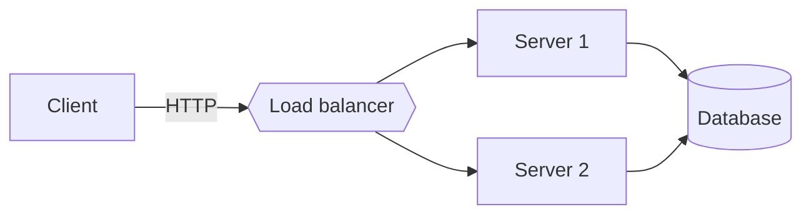
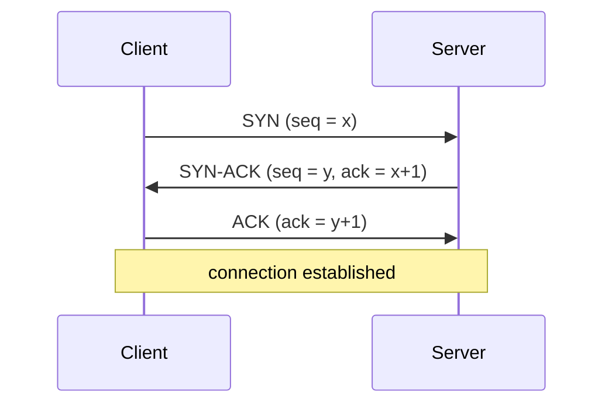
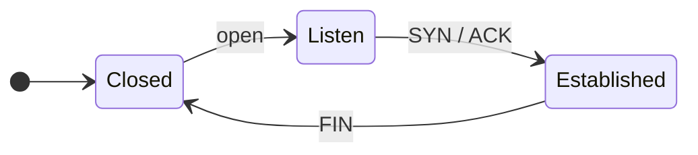

---
layout: toc
---

# Outline

---
layout: section
---

# Basics

Lists, emphasis, math and footnotes

---

# Example frame

## A subtitle directly below the title

- item 1
- *emphasis* is TUM blue, like `\emph` in the LaTeX template
  - test
  - $\ldots$
- **bold** and `inline code`

Citation [1][^1]

**Math mode should be fully functional:**

$$
\hat s \quad \overline s \quad \mathcal S \quad \boldsymbol S \quad \boldsymbol \Lambda \quad \sum_{i=1}^{n} x_i \quad \frac{\partial f}{\partial \xi} \quad \Pr[X=0]
$$

[^1]: J. Postel and J. Reynolds, *File Transfer Protocol (FTP)*, RFC 959, 1985.

---

# Step by step

<v-clicks>

- Points appear one after another
- Use `<v-clicks>` around a list
- Or `v-click` on any element

</v-clicks>

<Block title="Definition" v-click>

A *protocol* defines format and order of messages exchanged between two or more communicating entities.

</Block>

---
layout: two-cols
---

# Blocks

::left::

<Block title="Block">Default beamer block in TUM blue.</Block>

<Block type="example" title="Example">Like <code>exampleblock</code>.</Block>

<Block type="alert" title="Alert">Like <code>alertblock</code>.</Block>

::right::

<Block type="warning" title="Warning">Highlight in TUM orange.</Block>

<Block type="note" title="Note">Neutral, gray.</Block>

<Block title="Outline variant" outline>Framed like <code>moepdef</code>.</Block>

---

# Tables

| | Competitor 1 | Competitor 2 | we |
|---|:-:|:-:|:-:|
| Feature A | <No/> | <Maybe/> | <Yes/> |
| Feature B | <No/> | <Maybe/> | <Yes/> |
| Feature C | <No/> | <Maybe/> | <Yes/> |
| Feature D | <No/> | <Maybe/> | <Yes/> |

Tables use booktabs-style rules; `<Yes/>`, `<No/>` and `<Maybe/>` replace `\yes`, `\no`, `\maybe`.

---

# Code

```python {2-3|5}
def checksum(data: bytes) -> int:
    s = sum(int.from_bytes(data[i:i+2], "big") for i in range(0, len(data), 2))
    s = (s & 0xFFFF) + (s >> 16)
    return ~s & 0xFFFF

print(hex(checksum(b"\x45\x00\x00\x1c")))
```

Line highlighting steps through `{2-3|5}` on click.

---
layout: section
---

# Images & Diagrams

Figure layouts with automatic numbering

---
layout: image
image: /images/topology.svg
caption: A small network (recreated from figures/example.tikz)
---

# Figures

---
layout: image-right
image: /images/measurement.svg
caption: Measurement setup
width: 42%
---

# Image right

- Text on the left, figure on the right
- `width:` sets the size of the image column
- `fit: cover` fills the column edge to edge
- Use `layout: image-left` to swap sides

---
layout: image-left
image: /images/topology.svg
caption: Topology again, this time on the left
width: 50%
---

# Image left

The caption counter keeps going across all figure slides.

You can still place a figure anywhere with the component:

<Figure src="/images/setup.svg" height="110px" caption="Inline figure" />

---
layout: gallery
images:
  - src: /images/setup.svg
    caption: (a) Setup
  - src: /images/measurement.svg
    caption: (b) Measurement
  - src: /images/evaluation.svg
    caption: (c) Evaluation
---

# Gallery

---
layout: diagram
caption: Request flow through the system
---

# Diagrams with Mermaid



---
layout: diagram
caption: TCP three-way handshake
---

# Sequence diagram



---
layout: two-cols
cols: 1fr 1.3fr
---

# Diagram next to text

::left::

- Diagrams also work in any other layout
- Mermaid colors follow the TUM palette
- PlantUML works too (needs a PlantUML server)

::right::



---
layout: three-cols
---

# Three columns

::left::

### Problem
Existing approaches do not scale beyond a few hundred nodes.

::middle::

### Approach
Hierarchical aggregation with probabilistic sampling.

::right::

### Result
<span class="text-tum-green font-bold">10×</span> fewer messages at equal accuracy.

---
layout: fact
---

# 42 %

less latency than the baseline

---
layout: statement
---

# Make the key message one sentence.

---
layout: quote
source: Edsger W. Dijkstra
---

Simplicity is prerequisite for reliability.

---
layout: image-full
image: /images/pattern.svg
caption: Full-bleed background image
---

# Full-bleed image

With optional overlay title and caption

---
layout: section
variant: blue
---

# Wrap-up

---
layout: toc
highlight: current
---

# Outline

---
layout: references
---

# References

- [1] J. Postel and J. Reynolds, *File Transfer Protocol (FTP)*, RFC 959, IETF, 1985.
- [2] V. Cerf and R. Kahn, "A Protocol for Packet Network Intercommunication", *IEEE Trans. Commun.*, vol. 22, no. 5, 1974.
- [3] J. Saltzer, D. Reed and D. Clark, "End-to-End Arguments in System Design", *ACM TOCS*, vol. 2, no. 4, 1984.

---
layout: end
email: max.mustermann@example.org
web: www.tum.de
---
